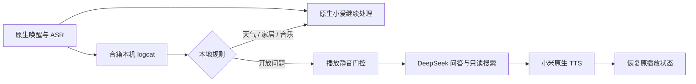

# XiaoSeek LX04

**给老款小爱触屏音箱接入 DeepSeek，保留原生天气、穿衣建议和米家控制。**

[](https://github.com/jarod360/xiaoai-deepseek-lx04/actions/workflows/ci.yml)
[](THIRD_PARTY.md)

[English](README.en.md) · [部署指南](docs/部署指南.md) · [完整技术报告](docs/改造过程与修改技术报告.md) · [兼容性与恢复](docs/兼容性与恢复.md)

仍然说“小爱同学”，接着直接提问，无需“请问”前缀。客户端、配置、语音事件监听和分流都在音箱上运行，日常不需要 NAS、树莓派或常开电脑。**模型推理与联网搜索使用 DeepSeek 云端 API，原生识别与播报沿用小米服务。**

| 你说 | 处理方式 |
| --- | --- |
| 今天天气怎么样？明天穿什么衣服？ | 原生小爱，保留当地天气链路 |
| 关灯、播放音乐、设置闹钟 | 原生小爱 |
| 彩虹是怎么形成的？唐朝人穿什么？ | DeepSeek |
| 现在排名靠前的大模型有哪些？ | DeepSeek 搜索后依据资料回答 |

## 2026-10-31 RC4 TTS 修复：基于 Work 实机源码整合

本次基底来自用户上传的 `xiaoseek.zip`，保留此前在音箱运行过的关键实现，不再用公开仓库原有的监听器覆盖 Work 修改：

- `client/cmd/lx04-agent/speech_listener.go`：logcat EOF 或中断后的自动重连，期间保留已认证的会话。
- `client/cmd/lx04-agent/doorbell.go`：本机门铃接收器状态检查、抢占取消及短暂恢复保护。接收器不可用时默认暂停 AI 答复，以免抢占门铃。
- `scripts/device-supervise.sh`：进程退出后自动拉起和有上限的指数退避；`disabled` 标记使守护循环停止。
- `scripts/device-service.sh`：Magisk 开机启动入口指向 `supervise.sh`；`device-run.sh` 继续提供 DNS、Android CA 及音频恢复环境。
- 原有本机 ASR、原生天气/米家分流、DeepSeek 联网搜索、静音门控、取消/恢复与日志处理保持原来的责任分工。

### TTS 协议：仅使用 RC4，不回退旧 TTS

`XiaoMi.MiTTSContext()` 的 UseCommand TTS 路径调用 `IOService.MiotActionMiGPT()`，原 TTS HMAC 请求不再参与这一调用。请求完整包含 RC4-drop1024、双层 SHA1 签名、12 字节加密随机 nonce、`datasource=2`、MICO User-Agent、MIoT Header 和 Xiaomi Cookie；响应使用 RC4 解密，按服务端指示处理 GZIP。

- 继续使用原有 `xiaomiio` SID、`ssecurity` 和 `serviceToken`；登录响应中的 `cUserId` 会被保存，已有旧 Token 仍可加载。
- HTTP 429 和其他错误只返回错误，**不自动重试、不切回旧协议**，避免叠加云端请求。
- `agent.answer()` 传递回答上下文到网络调用，门铃抢占或会话取消时可中断正在等待的请求。
- **非 TTS 的 MIoT 设备操作保留原接口**，避免把 TTS 实验协议推广到无关操作。
- 保留 TLS 证书校验；音箱启动环境需提供 `SSL_CERT_DIR=/system/etc/security/cacerts` 和有效 `XIAOBOT_DNS_SERVER`。

### 已验证与未验证

2026-10-31，在中国版 LX04 上，**独立的** `lx04-ttscheck -protocol migpt-rc4 -speak` 实测获得 `MIoT 5-1 accepted (code 0)`，且音箱实际播报了“DeepSeek 播报诊断测试。”；原旧协议此前曾返回 HTTP 429。这证明该协议组合在本次测试下可用，尚**不能证明**是哪一个字段导致旧 429，亦不代表服务端永不限流。

**新集成版**与此前独立测试程序不同：即使 GitHub Actions 构建成功，也还需要在音箱上做完整自然语言问答、门铃抢占、logcat 断线重连、音频恢复和开机守护的回归测试。部署之前请保留旧二进制、配置、Token 和启动脚本备份，避免直接覆盖正在运行的程序。

## 验证范围

已在**一台中国版 LX04，原厂固件 2.42.118，Android 8.1 / MT8167 / ARMv7 / 约 1 GB RAM**上完成改造。用户确认知识问答、原生天气、穿衣建议和联网搜索正常。完整技术报告同时记录失败尝试、启动写入范围与未覆盖的测试。

这是有源码和实机证据的社区工程版本，**不是通用一键刷机包**。其他固件、其他小爱型号尚未验证；公开版的设备选择与 DNS 已通用化，但尚未在第二台机器测试。已刷入的原机继续运行验收时版本。

## 架构



它从本机识别日志旁路增强小爱，通过临时主播放静音减少原生抢答；没有替换原生 NLP。分流是本地规则，搜索可以由时效规则或模型工具调用触发。每问最多两次搜索、三轮模型调用；搜索失败明确反馈，网页资料不获得执行命令或控制家居的权限。

## 获取与构建

需要 Git、Make、Python 3 和 `.go-version` 指定的 Go。仅编译不需要音箱或账号。

```sh
git clone https://github.com/jarod360/xiaoai-deepseek-lx04.git
cd xiaoai-deepseek-lx04
make test
make build
```

输出为 `dist/lx04-agent`、`lx04-bootstrap`、`lx04-netcheck`、`lx04-searchcheck` 和 `SHA256SUMS`，目标 `linux/arm GOARM=7 CGO_ENABLED=0`。完整客户端与两个本地依赖已包含，无需先克隆上游再打补丁。依赖下载慢时可自行设置合适的 `GOPROXY`；不需要关闭校验。

**已有认证 root ADB**：按[部署指南](docs/部署指南.md)配置账号、精确选择音箱并安装。**原厂锁定且没有 ADB**：先读[兼容性与恢复](docs/兼容性与恢复.md)及技术报告。不要把应用构建成功误当成已具备刷机条件；启动脚本保留了原机布局与散列边界。

## 仓库内容

| 路径 | 内容 |
| --- | --- |
| [`client/`](client/) | 完整客户端、事件/分流/音频/搜索/登录实现及单元测试 |
| [`third_party/ninego/`](third_party/ninego/) | 固定版本的 log、filelog 源码及许可 |
| [`scripts/`](scripts/) | 构建/检查、设备启动模板、启动镜像制作和边界检查脚本 |
| [`docs/改造过程与修改技术报告.md`](docs/改造过程与修改技术报告.md) | 从 USB、备份、V1–V6 到搜索验收的完整过程 |
| [`docs/实机操作记录.md`](docs/实机操作记录.md) | 历史操作记录，保留失败和阶段性状态 |
| [`docs/mtkclient-macos.patch`](docs/mtkclient-macos.patch) | 主机 USB 兼容修改 |
| [`docs/xiaobot-local.patch`](docs/xiaobot-local.patch) | 相对固定上游的客户端修改，可独立审阅 |
| [`speaker-config.example.json`](speaker-config.example.json)、[`device-match.example.json`](device-match.example.json) | 空凭证配置及设备匹配示例 |

启动锁计算、ramdisk/ADB 修改、B 槽写入/恢复、开机自启、账号验证和应用实现均开放。原厂固件、整机备份、真实账号、Key、令牌、ADB 密钥及对话日志保留在本机，不属于发布包。下载工具按官方来源获取。

## 使用与维护

见[使用与维护](docs/使用与维护.md)。附加程序可停用，并提供播放状态恢复入口。当前没有多轮对话记忆或屏幕回答展示；内置自动拉起守护脚本；主播放静音会暂时影响其他播放，规则也可能误分流。搜索与模型调用会产生费用，以 [DeepSeek 官方文档](https://api-docs.deepseek.com/guides/search/)及账户实际可用接口为准。

## 开源与致谢

默认 [Apache 2.0](LICENSE)；mtkclient 补丁及五个底层脚本为 GPL-3.0-only，MiService 保留 MIT。范围、固定提交和原作者署名见 [THIRD_PARTY.md](THIRD_PARTY.md) 与 [NOTICE](NOTICE)。感谢 xiaobot、ninego、xiaogpt、MiService、mtkclient、Magisk 及相关社区的工作。

欢迎通过 [Issue](https://github.com/jarod360/xiaoai-deepseek-lx04/issues) 提交脱敏后的复现信息，通过 PR 改进适配。参见[贡献指南](CONTRIBUTING.md)和[安全说明](SECURITY.md)。项目与小米、DeepSeek 无官方关联。
